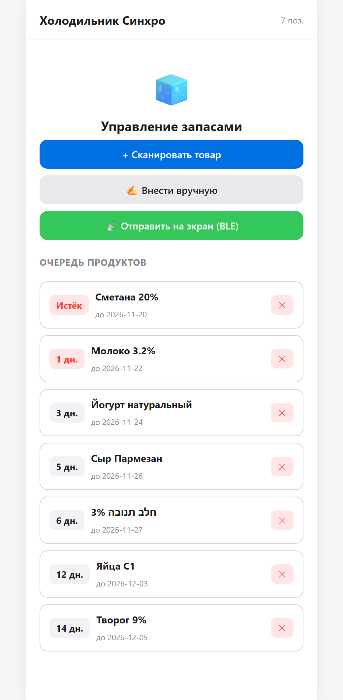
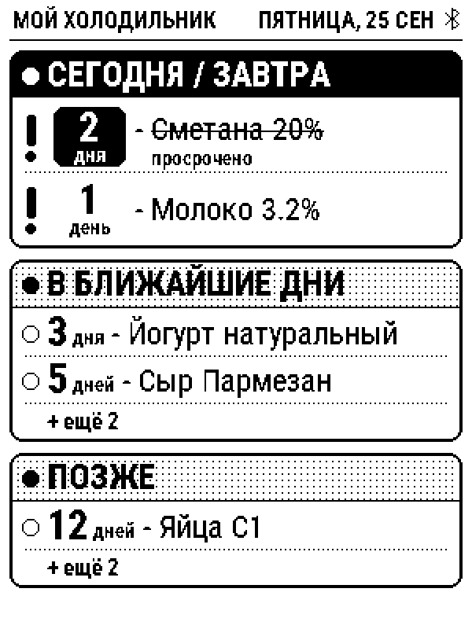

# Fridge Tracker

**An e-paper screen on the fridge door that shows what's about to expire.**

[Русская версия](README.ru.md)

You scan a product's barcode (or type it in) on your phone, pick the expiry date, and send the
list to a small e-ink display over Bluetooth. The display sorts everything into
"today / tomorrow", "next few days" and "later", counts the days down by itself every midnight,
and sleeps the rest of the time — so it runs for a long time on a battery.

<p align="center">
  
  &nbsp;&nbsp;
  
</p>

## Features

- **No app to install** — the phone side is a web page (Web Bluetooth + camera barcode scanner).
- **Barcode lookup** via [Open Food Facts](https://world.openfoodfacts.org/), plus a self-learning
  local database: once you name an unknown barcode, everyone on the same server gets that name.
- **Days are counted on the device.** The phone sends expiry dates and the current time once; the
  screen updates itself at local midnight.
- **Deep sleep.** The device wakes up only at midnight or when you press the button; Bluetooth is
  on for 2 minutes after a press.
- **Russian, English and Hebrew** product names, with right-to-left layout for Hebrew.
- **Everything urgent stays visible.** Products expiring today or tomorrow are never collapsed into
  "+ N more"; on a long list they switch to a compact layout instead.
- **Factory reset from the buttons**, to hand the device over to someone else.

## Supported hardware

| Device | Screen | Folder | BLE name |
|---|---|---|---|
| [Elecrow CrowPanel ESP32-S3 4.2" E-paper](https://www.elecrow.com/) (v1.2) | 400×300, black/white, fast partial refresh | [`firmware/crowpanel-42`](firmware/crowpanel-42) | `Fridge-Tracker` |
| [Zectrix NOTE4C](https://wiki.zectrix.com/en/hardware/note4c/quick-start) | 400×300, black/white/red/yellow, vertical or horizontal | [`firmware/zectrix-note4c`](firmware/zectrix-note4c) | `Fridge-Tracker-Color` |

Both are ESP32-S3 boards. Different BLE names let you keep both devices without mixing them up;
the same web page talks to either of them.

### Controls

| | CrowPanel | NOTE4C |
|---|---|---|
| Turn on Bluetooth for 2 min | any button | center button |
| Factory reset (hold 5 s, then confirm) | EXIT + MENU, confirm with the joystick | UP + DOWN, confirm with the center button |
| While Bluetooth is on | Bluetooth icon in the header | no icon (see below) |

The NOTE4C's 4-color panel can only redraw the whole screen, which takes more than 10 seconds,
so it does not show a Bluetooth icon by default. Set `SHOW_BLE_ICON 1` in the sketch if you want
it, at the cost of two full redraws per button press.

## Repository layout

```
site/                        web app: index.html + proxy.php (PHP + SQLite)
firmware/
  crowpanel-42/              firmware for Elecrow CrowPanel 4.2"
  zectrix-note4c/            firmware for Zectrix NOTE4C (vertical / horizontal)
  libraries/FridgeCommon/    shared code: bitmap fonts, BiDi text, data types
  tools/                     font generator, USB test tools, sample data
  build.sh                   builds all variants into firmware/dist/
docs/                        protocol description, images
```

## Quick start

### 1. Flash the device

**Easiest: use a prebuilt file** from [Releases](../../releases):

| File | Device |
|---|---|
| `fridge-tracker-crowpanel.bin` | Elecrow CrowPanel 4.2" |
| `fridge-tracker-note4c-vertical.bin` | Zectrix NOTE4C, hanging vertically |
| `fridge-tracker-note4c-horizontal.bin` | Zectrix NOTE4C, horizontal |

Flash it at address `0x0`, either in Chrome/Edge with Espressif's
[ESP Tool web flasher](https://espressif.github.io/esptool-js/), or with esptool:

```bash
python -m esptool --chip esp32s3 --baud 460800 write-flash 0x0 fridge-tracker-note4c-vertical.bin
```

> **Zectrix NOTE4C:** back up the factory firmware first, so you can go back to it:
> `python -m esptool --chip esp32s3 read-flash 0 0x1000000 note4c-factory.bin`.
> If the board doesn't show up as a serial port, hold the center (BOOT) button, press the RESET
> pinhole on the side once, then release BOOT.

**Or build it yourself** — see [Building](#building).

### 2. Open the web app

The web app needs HTTPS (Web Bluetooth and the camera only work on secure pages).
Host [`site/`](site) yourself — see [Hosting the web app](#hosting-the-web-app).

Browsers: Chrome on Android, Chrome or Edge on a computer. **On iPhone**, Safari does not support
Web Bluetooth — use the free **Bluefy – Web BLE Browser** from the App Store instead.

### 3. Send the list

1. Add products: **Scan** a barcode or **Add manually**, pick the expiry date.
2. Press the button on the device to turn on Bluetooth.
3. Tap **Send to screen (BLE)** and choose `Fridge-Tracker…` in the list.
4. The screen redraws with your list; from now on it updates itself every midnight.

## Hosting the web app

`site/` is plain HTML plus one PHP file:

- `index.html` — the whole app; the product list is stored in the phone's browser (localStorage).
- `proxy.php` — looks up barcodes in Open Food Facts (server-side, to avoid CORS) and stores
  names that users enter for unknown barcodes in `products.db` (SQLite, created automatically).
- `.htaccess` — forces HTTPS and blocks downloading `products.db` (Apache).

Requirements: PHP 7.4+ with `pdo_sqlite` and `curl`, HTTPS. On nginx, add the equivalent of the
`.htaccess` rules yourself — at least deny access to `*.db`.

If you run a **public** instance, keep in mind that names typed by any visitor are shared with
everyone (that's how the "self-learning" database works), and set a User-Agent with your contact
in `proxy.php`, as [Open Food Facts asks](https://openfoodfacts.github.io/openfoodfacts-server/api/).

## Building

Tested with Arduino core for ESP32 **3.3.12** and these libraries:
**GxEPD2 1.6.9**, **Adafruit GFX Library 1.13.0**, **ArduinoJson 7.4.3**.

### arduino-cli

```bash
arduino-cli core install esp32:esp32@3.3.12
arduino-cli lib install "GxEPD2@1.6.9" "Adafruit GFX Library@1.13.0" "ArduinoJson@7.4.3"
cd firmware
./build.sh              # all variants -> firmware/dist/*.bin
./build.sh note4c-v     # or one: crowpanel | note4c-v | note4c-h
```

### Arduino IDE

1. Copy `firmware/libraries/FridgeCommon` into your Arduino `libraries` folder
   (e.g. `Documents/Arduino/libraries`). It holds the fonts and shared code used by both sketches.
2. Install the libraries above via *Library Manager*.
3. Open `firmware/zectrix-note4c/zectrix-note4c.ino` (or `crowpanel-42`).
4. *Tools*: Board **ESP32S3 Dev Module**, PSRAM **OPI PSRAM**, Partition Scheme **Huge APP**;
   for NOTE4C also Flash Size **16MB** and **USB CDC On Boot: Enabled**.
5. NOTE4C orientation: `#define ORIENTATION 1` (vertical, default), `3` (vertical, flipped)
   or `0` (horizontal) at the top of the sketch.

### Fonts

`fonts.h` is generated. To change sizes or add characters, edit `firmware/tools/gen_fonts.py` and run
`python firmware/tools/gen_fonts.py` (needs Pillow).

### Screenshots without waiting for e-ink

Both firmwares can send the current screen over USB:

```bash
python firmware/tools/shot4c.py COM5 send firmware/tools/sample.json note4c.png   # NOTE4C
python firmware/tools/dev.py send firmware/tools/sample.json shot.png              # CrowPanel
```

`pip install pyserial pillow` first. The device has to be awake — press the button first.
`dev.py` uses COM4; set the `FRIDGE_PORT` environment variable to use another port.

## How it works

- The phone keeps the list and sends the **whole list** each time, together with the current time
  and time zone. The protocol is described in [docs/protocol.md](docs/protocol.md).
- The device stores the list in flash, sets its clock, draws the screen and goes to deep sleep.
  A timer wakes it at 00:00:30 local time to recount days; a button wakes it for Bluetooth.
- After a power loss the device shows "НУЖНА СИНХРОНИЗАЦИЯ" (sync needed) until the phone sends the
  time again. The NOTE4C keeps time in its PCF8563 real-time clock, so it usually doesn't need that.

## Known limitations

- NOTE4C: the panel only does full refreshes (10+ seconds). Partial refresh commands make the
  controller redraw the whole screen in black and white, so the firmware never uses them.
- NOTE4C: the power-latch level (GPIO17) and sleep current on battery have not been measured yet.
- The interface — both the screen and the web app — is in Russian.

## License

[GPL-3.0-or-later](LICENSE). Fonts and libraries have their own licenses — see
[THIRD_PARTY_NOTICES.md](THIRD_PARTY_NOTICES.md).
