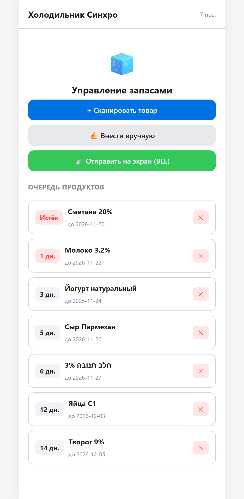
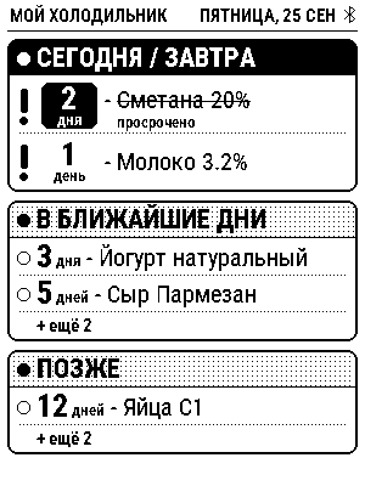

# Fridge Tracker

**Экран на электронных чернилах на дверце холодильника, который показывает, что скоро испортится.**

[English version](README.md)

На телефоне вы сканируете штрихкод продукта (или вписываете название), выбираете срок годности и
отправляете список на маленький e-ink-экран по Bluetooth. Экран раскладывает продукты по зонам
«сегодня / завтра», «в ближайшие дни» и «позже», сам пересчитывает дни каждую полночь, а всё
остальное время спит — поэтому от батареи работает долго.

<p align="center">
  
  &nbsp;&nbsp;
  
</p>

## Возможности

- **Ничего не нужно устанавливать.** На телефоне — обычная веб-страница (Web Bluetooth и сканер
  штрихкодов через камеру).
- **Поиск по штрихкоду** в [Open Food Facts](https://world.openfoodfacts.org/) и самообучающаяся база:
  если вы один раз назвали неизвестный штрихкод, это название получат все, кто пользуется тем же сервером.
- **Дни считает само устройство.** Телефон один раз присылает сроки и текущее время, дальше экран
  обновляется сам в полночь по местному времени.
- **Глубокий сон.** Устройство просыпается только в полночь или по кнопке; Bluetooth включается
  на 2 минуты после нажатия.
- **Русский, английский и иврит** в названиях продуктов; иврит выводится справа налево.
- **Срочное видно всегда.** Продукты, которые истекают сегодня или завтра, никогда не сворачиваются
  в «+ ещё N»: если их много, они переходят в компактный вид.
- **Сброс кнопками** — чтобы передать устройство другому человеку.

## Поддерживаемые устройства

| Устройство | Экран | Папка | Имя в Bluetooth |
|---|---|---|---|
| [Elecrow CrowPanel ESP32-S3 4.2" E-paper](https://www.elecrow.com/) (v1.2) | 400×300, чёрно-белый, быстрое частичное обновление | [`firmware/crowpanel-42`](firmware/crowpanel-42) | `Fridge-Tracker` |
| [Zectrix NOTE4C](https://wiki.zectrix.com/en/hardware/note4c/quick-start) | 400×300, чёрный/белый/красный/жёлтый, вертикально или горизонтально | [`firmware/zectrix-note4c`](firmware/zectrix-note4c) | `Fridge-Tracker-Color` |

Обе платы на ESP32-S3. Имена в Bluetooth разные, чтобы два устройства не путались; сайт один и тот
же и работает с любым из них.

### Кнопки

| | CrowPanel | NOTE4C |
|---|---|---|
| Включить Bluetooth на 2 минуты | любая кнопка | центральная кнопка |
| Сброс всех данных (держать 5 с, потом подтвердить) | EXIT + MENU, подтвердить джойстиком | UP + DOWN, подтвердить центральной кнопкой |
| Пока включён Bluetooth | значок в шапке | без значка (см. ниже) |

4-цветный экран NOTE4C умеет обновляться только целиком, и это занимает больше 10 секунд,
поэтому значок Bluetooth по умолчанию не показывается. Его можно включить в скетче
(`SHOW_BLE_ICON 1`), но тогда каждое нажатие кнопки будет стоить двух полных перерисовок.

## Что где лежит

```
site/                        сайт: index.html + proxy.php (PHP + SQLite)
firmware/
  crowpanel-42/              прошивка для Elecrow CrowPanel 4.2"
  zectrix-note4c/            прошивка для Zectrix NOTE4C (вертикально / горизонтально)
  libraries/FridgeCommon/    общий код: растровые шрифты, вывод иврита, типы данных
  tools/                     генератор шрифтов, утилиты для USB, тестовые данные
  build.sh                   собирает все варианты в firmware/dist/
docs/                        описание протокола, картинки
```

## Быстрый старт

### 1. Прошить устройство

**Проще всего — готовым файлом** со страницы [Releases](../../releases):

| Файл | Устройство |
|---|---|
| `fridge-tracker-crowpanel.bin` | Elecrow CrowPanel 4.2" |
| `fridge-tracker-note4c-vertical.bin` | Zectrix NOTE4C, висит вертикально |
| `fridge-tracker-note4c-horizontal.bin` | Zectrix NOTE4C, горизонтально |

Файл прошивается с адреса `0x0` — в Chrome или Edge через веб-прошивальщик Espressif
[ESP Tool](https://espressif.github.io/esptool-js/) или через esptool:

```bash
python -m esptool --chip esp32s3 --baud 460800 write-flash 0x0 fridge-tracker-note4c-vertical.bin
```

> **Zectrix NOTE4C:** сначала сохраните заводскую прошивку, чтобы можно было к ней вернуться:
> `python -m esptool --chip esp32s3 read-flash 0 0x1000000 note4c-factory.bin`.
> Если плата не появляется как COM-порт: зажмите центральную кнопку (BOOT), один раз нажмите RESET
> в отверстии сбоку и отпустите BOOT.

**Или соберите сами** — см. [Сборка](#сборка).

### 2. Открыть сайт

Сайт должен открываться по HTTPS: Web Bluetooth и камера работают только на защищённых страницах.
Папку [`site/`](site) нужно разместить на своём хостинге — см. [Свой хостинг сайта](#свой-хостинг-сайта).

Браузеры: Chrome на Android, Chrome или Edge на компьютере. **На iPhone** Safari не поддерживает
Web Bluetooth — используйте бесплатный браузер **Bluefy – Web BLE Browser** из App Store.

### 3. Отправить список

1. Добавьте продукты: **Сканировать товар** или **Внести вручную**, выберите срок годности.
2. Нажмите кнопку на устройстве, чтобы включить Bluetooth.
3. На сайте нажмите **Отправить на экран (BLE)** и выберите в списке `Fridge-Tracker…`.
4. Экран перерисуется с вашим списком; дальше он сам обновляется каждую полночь.

## Свой хостинг сайта

`site/` — это обычный HTML и один PHP-файл:

- `index.html` — всё приложение; список продуктов хранится в браузере телефона (localStorage).
- `proxy.php` — ищет штрихкоды в Open Food Facts (с сервера, чтобы обойти CORS) и сохраняет названия,
  которые пользователи вводят для неизвестных штрихкодов, в `products.db` (SQLite, создаётся сам).
- `.htaccess` — принудительный HTTPS и запрет скачивания `products.db` (для Apache).

Нужно: PHP 7.4+ с `pdo_sqlite` и `curl`, HTTPS. На nginx правила из `.htaccess` нужно перенести
самостоятельно — как минимум запретить доступ к `*.db`.

Если сайт будет **публичным**, учтите: названия, которые вводит любой посетитель, видят все
(так работает самообучающаяся база). И укажите в `proxy.php` User-Agent с контактом,
как [просит Open Food Facts](https://openfoodfacts.github.io/openfoodfacts-server/api/).

## Сборка

Проверено на ядре Arduino для ESP32 **3.3.12** и библиотеках
**GxEPD2 1.6.9**, **Adafruit GFX Library 1.13.0**, **ArduinoJson 7.4.3**.

### arduino-cli

```bash
arduino-cli core install esp32:esp32@3.3.12
arduino-cli lib install "GxEPD2@1.6.9" "Adafruit GFX Library@1.13.0" "ArduinoJson@7.4.3"
cd firmware
./build.sh              # все варианты -> firmware/dist/*.bin
./build.sh note4c-v     # или один: crowpanel | note4c-v | note4c-h
```

### Arduino IDE

1. Скопируйте `firmware/libraries/FridgeCommon` в папку библиотек Arduino
   (например, `Documents/Arduino/libraries`). Там шрифты и общий код для обеих прошивок.
2. Установите библиотеки выше через *Library Manager*.
3. Откройте `firmware/zectrix-note4c/zectrix-note4c.ino` (или `crowpanel-42`).
4. В меню *Tools*: Board **ESP32S3 Dev Module**, PSRAM **OPI PSRAM**, Partition Scheme **Huge APP**;
   для NOTE4C ещё Flash Size **16MB** и **USB CDC On Boot: Enabled**.
5. Ориентация NOTE4C — в начале скетча: `#define ORIENTATION 1` (вертикально, по умолчанию),
   `3` (вертикально, перевёрнуто) или `0` (горизонтально).

### Шрифты

`fonts.h` генерируется. Чтобы поменять размеры или добавить символы, поправьте
`firmware/tools/gen_fonts.py` и запустите `python firmware/tools/gen_fonts.py` (нужен Pillow).

### Скриншоты без ожидания e-ink

Обе прошивки умеют отдавать текущий экран по USB:

```bash
python firmware/tools/shot4c.py COM5 send firmware/tools/sample.json note4c.png   # NOTE4C
python firmware/tools/dev.py send firmware/tools/sample.json shot.png              # CrowPanel
```

Сначала `pip install pyserial pillow`. Устройство в этот момент должно не спать — сначала нажмите кнопку.
`dev.py` работает с COM4; другой порт задаётся переменной окружения `FRIDGE_PORT`.

## Как это работает

- Список хранится на телефоне и каждый раз отправляется **целиком** вместе с текущим временем
  и часовым поясом. Протокол описан в [docs/protocol.md](docs/protocol.md) (на английском).
- Устройство сохраняет список во flash, выставляет часы, рисует экран и уходит в глубокий сон.
  В 00:00:30 по местному времени его будит таймер, чтобы пересчитать дни; кнопка будит для Bluetooth.
- После пропадания питания устройство показывает «НУЖНА СИНХРОНИЗАЦИЯ», пока телефон снова не
  пришлёт время. У NOTE4C время хранится в часах PCF8563, поэтому обычно это не требуется.

## Известные ограничения

- NOTE4C: экран обновляется только целиком (10+ секунд). Команды частичного обновления заставляют
  контроллер перерисовать весь экран в чёрно-белом, поэтому прошивка их не использует.
- NOTE4C: уровень защёлки питания (GPIO17) и ток во сне от батареи ещё не измерены.
- Интерфейс — и на экране, и на сайте — на русском.

## Лицензия

[GPL-3.0 или новее](LICENSE). У шрифтов и библиотек свои лицензии — см.
[THIRD_PARTY_NOTICES.md](THIRD_PARTY_NOTICES.md).
